# 🐾 WithPet (위드펫) — 반려견 동반 가능 장소 검색 앱

반려견의 **몸무게·맹견 여부 같은 입장 조건**으로 동반 가능한 장소를 찾을 수 있는 안드로이드 앱입니다.
컴퓨터소프트웨어학과 졸업작품(2021)으로 5인 팀이 제작했습니다.

> 이 저장소는 졸업작품 최종 보고서를 바탕으로 프로젝트의 기획, 구조, 구현 내용, 실행 화면을 정리한 문서입니다.

---

## 📌 만든 이유

- 반려견 산책 앱은 대부분 **현위치, 장소 이름, 지역, 카테고리**로만 검색할 수 있습니다.
- 반려견과 함께 갈 때 실제로 중요한 **입장 조건**(견종·크기·몸무게·입마개 여부 등)은 장소 상세 정보에서 일일이 확인해야 합니다. 조건이 맞지 않으면 입장이 거부될 수도 있습니다.
- 그래서 **입장 조건과 지역으로 바로 검색**하고, 내 반려견 정보를 등록해 두면 **조건을 자동으로 맞춰 검색**해 주는 앱을 만들기로 했습니다.

## ✨ 주요 기능

| 기능 | 설명 |
|---|---|
| 회원가입 / 로그인 | 이름, 아이디, 비밀번호로 가입하고 서버에 저장된 정보와 대조해 로그인 |
| 홈 | 펫티켓 안내 배너, 추천 장소, 카테고리(카페·식당·백화점)별 목록 |
| 검색 · 필터 | 지역, 카테고리, 제한 몸무게, 전용/동반 여부, 맹견 출입 여부로 장소 검색 |
| 반려견 등록 | 이름, 몸무게, 맹견 여부, 성별, 나이, 특징을 저장하고 여러 마리 등록 가능 |
| 맞춤 검색 | 등록한 반려견 프로필을 고르면 그 조건이 자동으로 설정되어 검색 |
| 장소 상세 | 장소 이름, 위치, 사진 확인 |
| 지도 | 현재 위치 중심 지도에 장소를 마커로 표시, 길 찾기 연결 |
| 찜 | 하트 버튼으로 장소를 찜하고 찜 탭에서 모아보기 |

## 🏗 구조

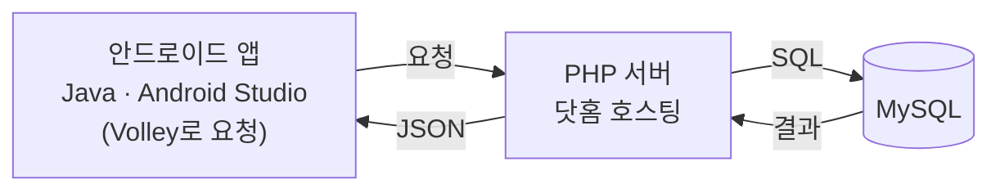

앱의 모든 기능은 서버와의 통신으로 동작합니다. 앱이 입력값을 PHP로 보내면 PHP가 MySQL에서 조회·저장한 뒤 결과를 JSON으로 돌려주고, 앱은 이를 화면에 표시합니다.

### 화면 구성

| 구성 요소 | 역할 |
|---|---|
| Loading Activity | 앱 시작 시 로딩 화면을 3초 보여 준 뒤 로그인 화면으로 이동 |
| Login / Register Activity | 로그인, 회원가입 (서버와 통신해 성공·실패를 Toast로 안내) |
| Main Activity | 하단 탭(홈·지도·찜·마이페이지)으로 화면 전환 |
| Home Fragment | 자동 슬라이더 배너, 추천 장소 리스트(RecyclerView), 카테고리 이동 |
| Cafe / Park / Restaurant Activity | 카테고리별 장소 목록, 상세 화면(ShopInfo) 이동 |
| Search Activity | 이름 검색과 조건 필터 |
| Map Fragment | Google Maps에 DB의 위도·경도로 마커 표시 |
| Like Fragment | 찜한 장소 목록 |
| MyPage Fragment | 반려견 등록·관리 |
| Customize Activity | 반려견 프로필 선택 후 맞춤 검색 |

## 🗄 데이터베이스

phpMyAdmin으로 관리한 MySQL 테이블 4개로 구성했습니다.

| 테이블 | 용도 | 주요 칼럼 |
|---|---|---|
| `Member` | 사용자 정보 | ID(PK), PW, Name |
| `Place` | 장소 정보 | Place_id(PK, 자동 증가), 이름, 주소, 위도·경도, 카테고리, 등급, 제한 몸무게, 전용 여부, 대표·세부 이미지, 맹견 가능 여부 |
| `Dog` | 반려견 정보 | Dog_id(PK, 자동 증가), 보호자 ID(FK), 이름, 몸무게, 맹견 여부, 성별, 나이, 특징 |
| `Liked` | 찜한 장소 | L_ID(PK, 자동 증가), ID(FK), Place_id(FK) |

- 장소의 위도·경도는 지도 마커를 찍는 데 사용합니다.
- 맹견 여부처럼 참/거짓 값을 쓰는 칼럼은 기본값을 지정해 입력을 줄였습니다.

## 🔍 입장 조건 검색은 이렇게 동작합니다

앱의 차별점인 입장 조건 검색은 **서버의 PHP가 조건을 받아 SQL로 조회**하는 방식으로 구현했습니다.

- **검색 · 필터:** 앱이 이름, 지역, 카테고리, 몸무게, 맹견 여부 등 필터 값을 보내면 서버가 `Place` 테이블에서 조건에 맞는 장소를 찾아 JSON 배열로 응답합니다.
- **맞춤 검색:** 앱이 선택한 반려견의 ID만 보내면 서버가 `Dog` 테이블의 몸무게·맹견 여부와 `Place` 테이블의 제한 조건을 비교해 입장 가능한 장소를 찾습니다.

### 핵심 로직 (보고서 발췌, 서버 주소·접속 정보는 제외)

**① 맞춤 검색 SQL (`Custom.php`)** — 선택한 반려견의 몸무게·맹견 여부로 입장 가능한 장소를 찾습니다.

```sql
SELECT Place_id, P_name, P_address, P_image
FROM Place, Dog
WHERE (Place.P_kg NOT BETWEEN 0 AND Dog.D_kg
       OR Place.P_kg IS NULL AND Place.P_sav <= Dog.D_sav)
  AND Dog.Dog_id = ?
```

- 장소의 제한 몸무게가 내 반려견 몸무게보다 크면 입장 가능한 장소로 봅니다.
- 몸무게 제한이 없는 장소(`NULL`)는 맹견 조건을 비교해 걸러냅니다.

**② 앱과 서버의 통신 (Volley)** — 입력값을 요청 객체에 담아 서버로 보내고, JSON 응답을 받아 화면에 반영합니다.

```java
LoginRequest loginRequest = new LoginRequest(ID, PW, responseListener);
RequestQueue queue = Volley.newRequestQueue(LoginActivity.this);
queue.add(loginRequest);   // 서버의 PHP가 DB를 조회하고 JSON으로 응답
```

## 📱 실행 화면

### UI 설계 시안
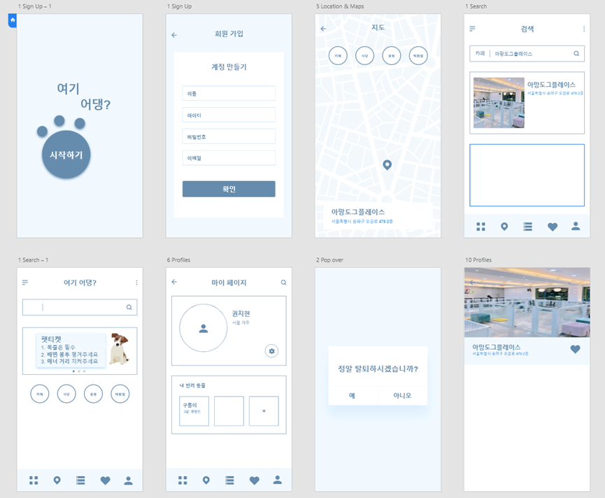

### 구현 화면

| 로딩 | 로그인 · 회원가입 | 홈 |
|---|---|---|
| 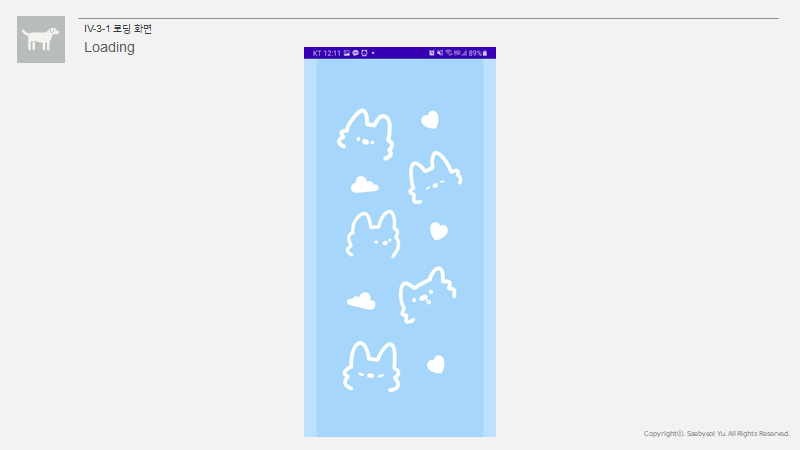 | 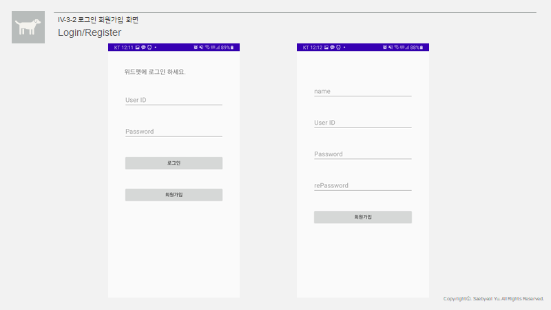 | 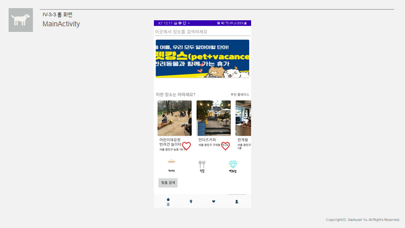 |

| 검색 · 필터 | 장소 상세 | 마이페이지 · 반려견 등록 |
|---|---|---|
| 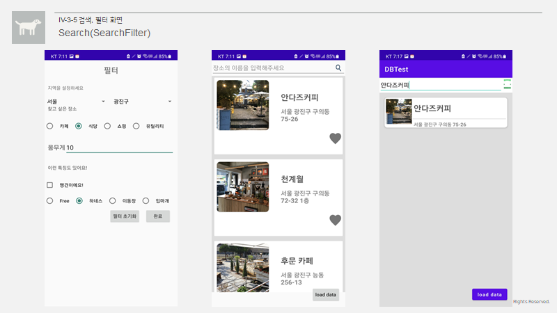 | 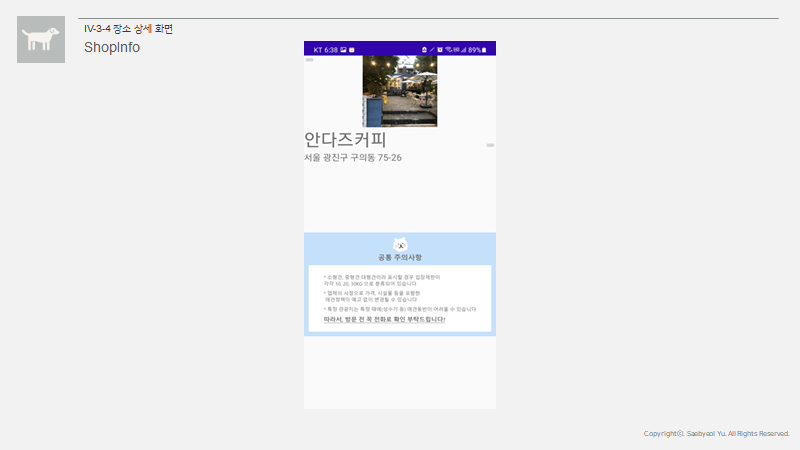 | 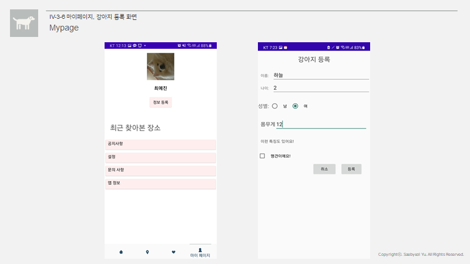 |

| 맞춤 검색 | 찜 | 지도 |
|---|---|---|
| 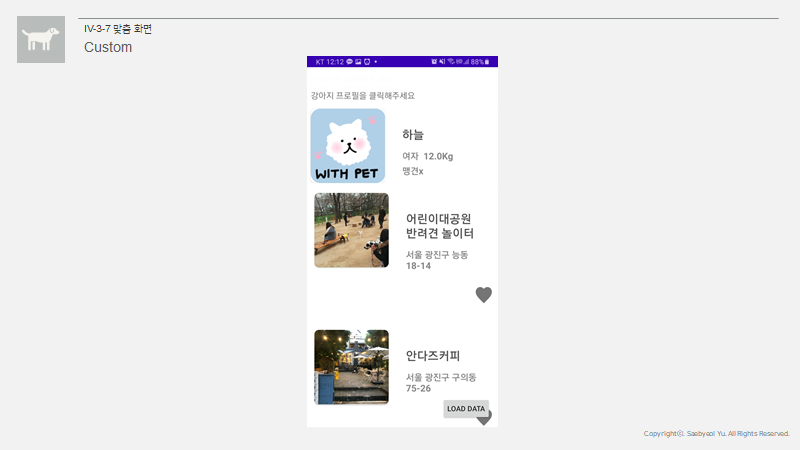 | 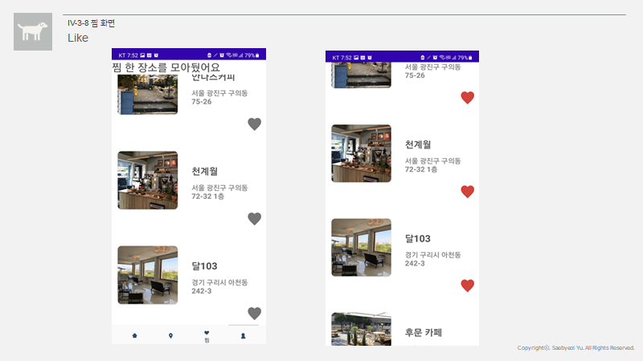 | 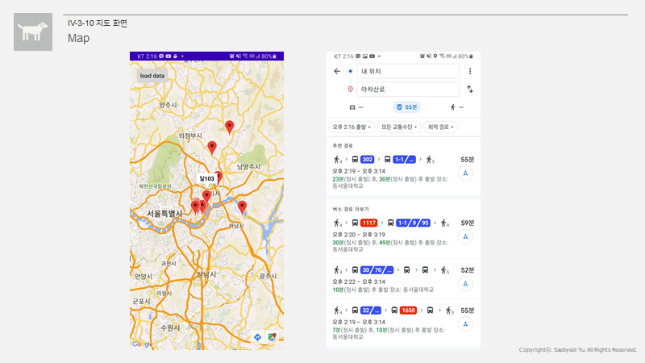 |

## 🧪 테스트

- 구조를 파악한 뒤 검증 기준과 테스트 데이터를 준비해 **기능 테스트, 성능 테스트, UI 테스트, 인수 테스트** 항목을 점검했습니다. 통합 테스트는 최소 단위 모듈에서 시작해 쌓아 올리는 방식을 썼습니다.
- 기능 테스트: 회원가입·로그인(정상·비정상 입력별 안내 메시지), 지도 마커, 반려견 관리, 검색·필터, 맞춤, 찜 등록·해제
- 성능 기준: 반응 시간 3초 이내, 동시 접속 가능 여부, Android Oreo 이상 기기에서 실행

## ⚠️ 한계와 아쉬운 점

보고서에 정리한 아쉬운 점입니다.

- 핵심인 입장 조건 검색은 구현을 마쳤지만, **앱 디자인과 UI, 데이터, 보안, 일부 기능**은 부족했습니다.
- 홈 화면과 찜 화면에서 찜 등록 시 **데이터 무결성은 확인하지 못했습니다.**
- 이름·조건으로 조회하는 SQL의 조건 묶음과 입력값 처리 방식, 비밀번호 저장 방식은 보안과 정확도 면에서 개선이 필요합니다.
- 한글이 들어간 아이디는 인코딩 문제로 로그인이 되지 않는 경우가 있었습니다.

## 💡 배운 점

- Java와 Android Studio, PHP, MySQL을 이용해 **앱 · 서버 · DB가 연결되는 전체 흐름**을 비교적 깊게 공부했습니다.
- 개인 프로젝트가 아닌 **팀 프로젝트**로 진행하며 협업의 중요성을 느꼈습니다. 코로나19로 대면 회의가 어려워 온라인 통화와 소규모 회의로 진행했습니다.

## 🛠 Tech Stack

`Java` `Android Studio` `Volley` `Glide` `Google Maps` `PHP` `MySQL` `phpMyAdmin` `닷홈 호스팅`
